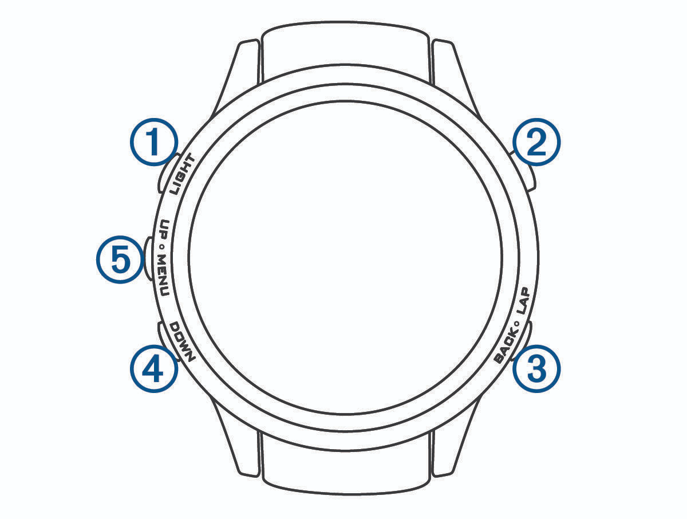

# fēnix 5 button guide

**Hold** means about 0.7 seconds. **Double-press** means pressing UP or DOWN twice within about 0.45 seconds; the app waits briefly before handling a single UP/DOWN press. The app does not use the touchscreen. **LIGHT** controls the watch backlight and has no app-specific action.

### Loading

- BACK: Exit if no active workout is restored. Otherwise, use the controls for the restored workout state.
- Other buttons: No app action while loading.

### Workout preview

- START/STOP: Start the workout.
- Hold START/STOP: Enter Demo mode.
- BACK/LAP: Exit the app.
- UP/MENU, DOWN: No app action.

### Connection or unsupported-workout error

- BACK/LAP: Exit the app.
- Other buttons: No app action.

### Working

- START/STOP: Log the selected planned set; AMRAP opens the reps editor.
- Hold START/STOP: Edit reps, including a previously completed set.
- BACK/LAP: Return to the active exercise’s next set; if already there, open workout options.
- UP/MENU: Previous set; double-press jumps to the previous exercise.
- Hold UP/MENU: Toggle the extra row between estimated 1RM and plates per side.
- DOWN: Next set; double-press or hold jumps to the next exercise.

### Editing reps

- START/STOP: Save/log. For unilateral sets, the first short press moves from left-side reps to right-side reps; the next saves. Hold to save immediately.
- BACK/LAP: Cancel editing and return to the workout.
- UP/MENU: Increase the selected reps.
- DOWN: Decrease the selected reps.

### Rest countdown

- START/STOP: On the active next AMRAP set, skip rest and open the reps editor; otherwise no action.
- BACK/LAP: Return to the next set, or cancel rest when already on it.
- UP/MENU: Previous set; double-press jumps to the previous exercise.
- Hold UP/MENU: Toggle the extra row between estimated 1RM and plates per side.
- DOWN: Next set; double-press or hold jumps to the next exercise.

### Workout complete

- START/STOP: Finish and save the workout.
- BACK/LAP: Open workout options.
- UP/MENU: Browse to the previous set; double-press jumps to the previous exercise.
- DOWN: Browse to the next set; double-press jumps to the next exercise.

### Workout options

- START/STOP: Activate the selected option: Leave/Keep Workout, Finish, Undo (when available), or Discard.
- BACK/LAP: Close options and return to the workout.
- UP/MENU, DOWN: Move the selection up/down; selection wraps around.

### Confirm finish

- START/STOP: Confirm and save the workout.
- BACK/LAP: Cancel and return to the workout.
- UP/MENU, DOWN: No app action.

### Confirm undo

- START/STOP: Undo the selected completed set, or the last completed set if none is selected.
- BACK/LAP: Cancel and return to workout options.
- UP/MENU, DOWN: No app action.

### Confirm discard

- START/STOP: Confirm discarding the workout. This cannot be undone.
- BACK/LAP: Cancel and return to the workout.
- UP/MENU, DOWN: No app action.

### Saving or discarding

- All buttons: No app action; wait for the request to finish.

### Demo mode

- Buttons: Same as the corresponding preview/workout screen.
- Finish/cancel: Return to preview; changes are not sent to Liftosaur.
