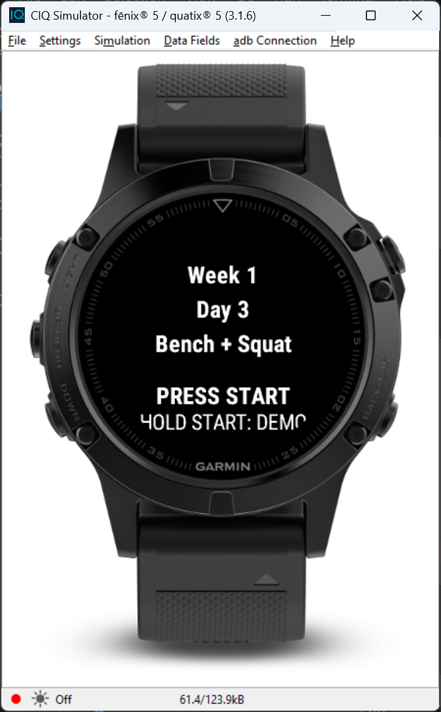
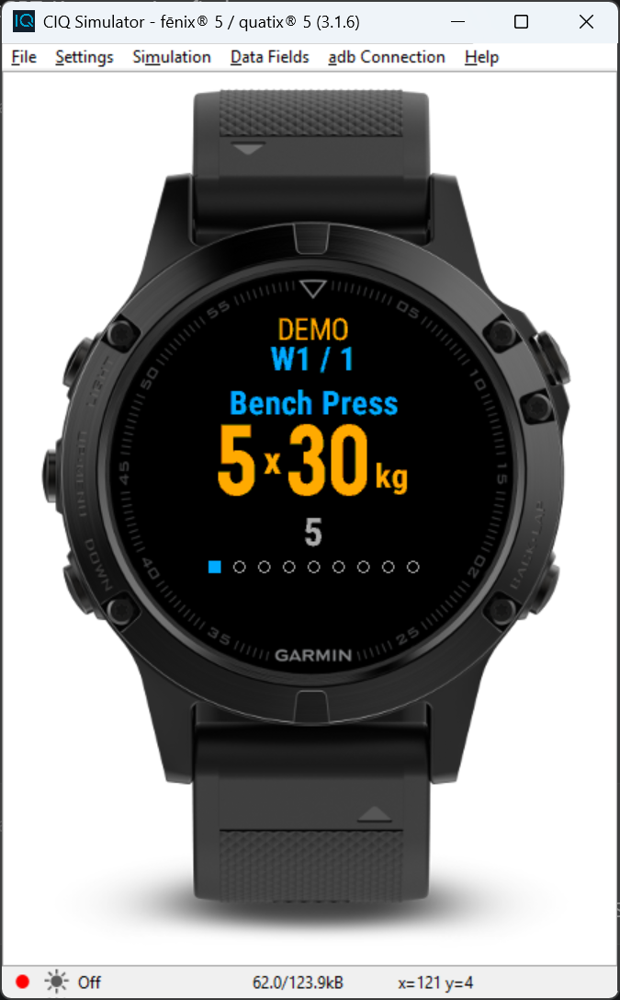
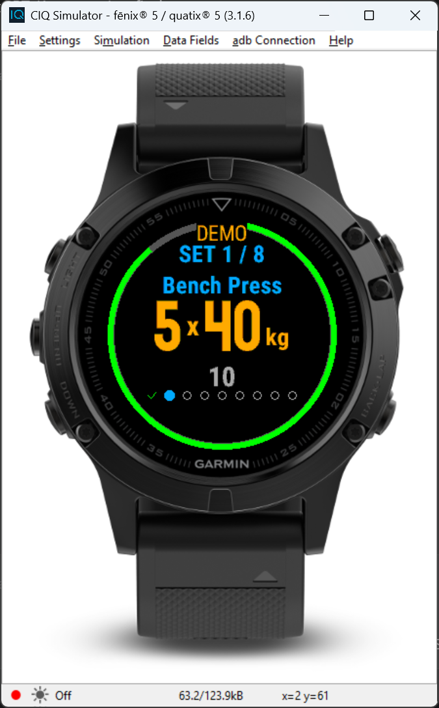
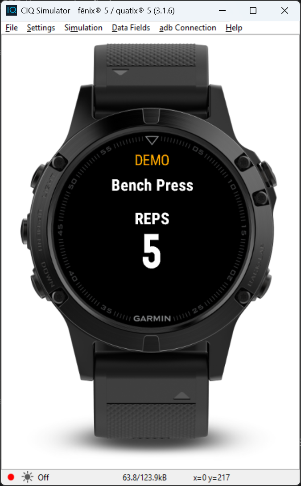
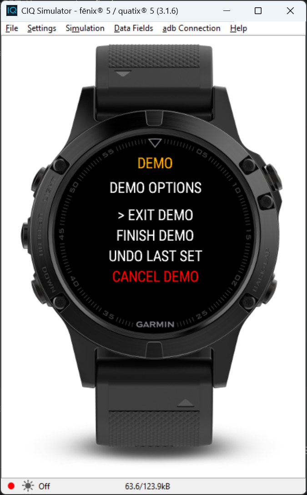

# Garmin Connect IQ Store listing

## App name

Toms Liftosaur Workout Companion

## Short description

Control Liftosaur workouts from your fēnix 5. Log sets, track rest, and sync progress to Liftosaur.

## Full description

Take your Liftosaur workout to the gym on your fēnix 5. Preview your next workout, start it from your watch, log sets as you train, and follow rest countdowns. Your completed sets sync to Liftosaur, where your workout history and progression are managed.

**Features**
- Preview and start your next Liftosaur workout.
- Log sets and edit reps, including AMRAP and unilateral sets.
- Follow rest timers with a vibration when rest ends.
- Queue completed sets on the watch when the connection drops and retry syncing later.
- Try the workout screens in Demo mode without sending workout changes to Liftosaur.

**What you need**
- A Garmin fēnix 5.
- A Liftosaur account with Premium API access and your Liftosaur API key entered in the app settings.
- A phone paired with the watch and running Garmin Connect. A connection is required to fetch and start workouts; queued set completions can retry when connectivity returns.

**Limitations**
- Version 1 supports standard and warmup sets. Workouts with supersets, timed sets, RPE prompts, or other prompted set types cannot be started in the app.
- This app sends workout information to Liftosaur. It does not record a Garmin Connect activity.

## Controls

See [fēnix 5 button guide](FENIX5_CONTROLS.md) for the button illustration and state-by-state controls.

## Screenshots

